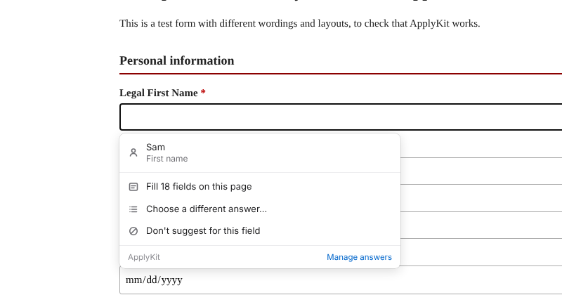
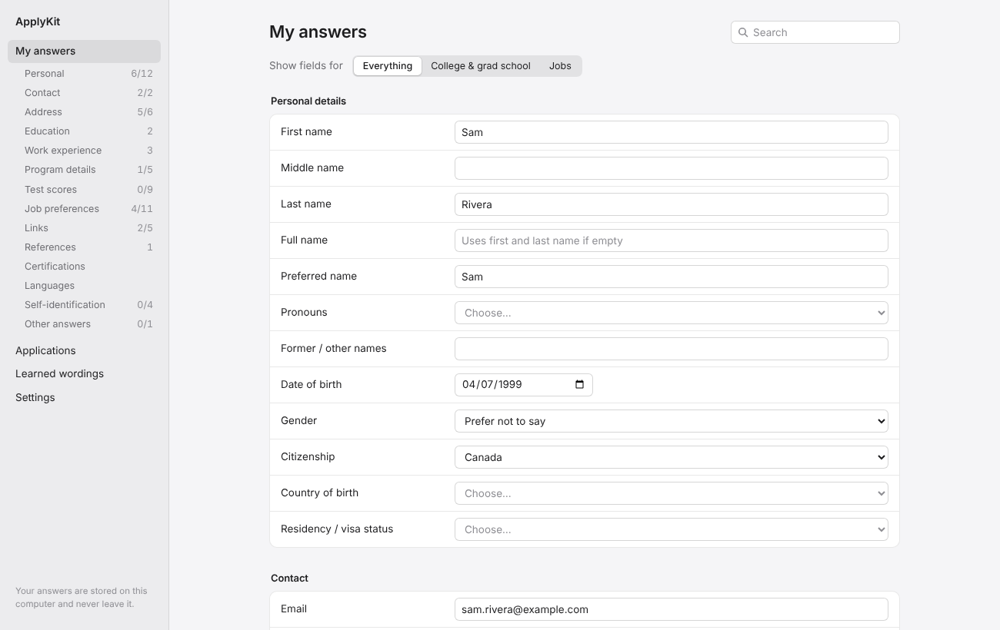
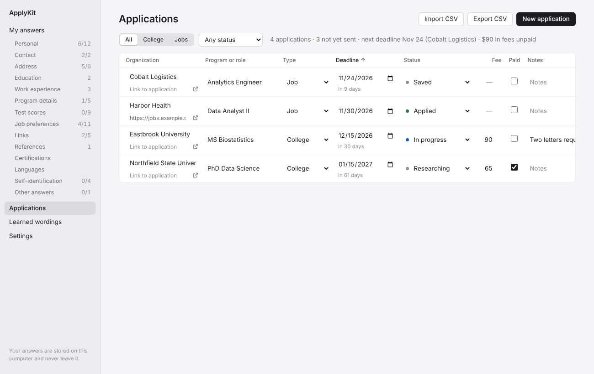

# ApplyKit

A Chrome extension that fills in college and job applications for you and keeps track of where you've applied.

You save your answers once: name, contact details, education, work history, references, test scores, job preferences. When you click into a field on an application, ApplyKit suggests the right answer underneath it, the way your browser suggests a saved password. If a form words a question in an unusual way, pick the right answer once and ApplyKit remembers that wording on every later form.



## What it does

**Fills forms**
- Shows a menu under each field it recognises. Choose the answer or press Enter, or fill every field on the page at once (<kbd>Alt</kbd>+<kbd>Shift</kbd>+<kbd>F</kbd>).
- Fills repeated sections. Your first school goes in the first education block, your second in the second, and so on. Numbered blocks such as "Employer 2" get the matching entry. If a form shows fewer blocks than you have entries, ApplyKit tells you how many are left over.
- Picks dropdown options by meaning:
  - *Master of Science (M.S.)* fills *Master's Degree*
  - *Illinois* fills *IL*
  - *Prefer not to say* fills *Decline to self-identify*
  - Dates are split into separate month and year fields, or written as *MM/YYYY*, when a form asks for that.
- Handles yes/no questions, checkboxes ("I currently work here", Remote / Hybrid / On-site), radio buttons, date pickers, iframes and web components.
- Leaves certain fields alone:
  - It never puts *your* name or email into a recommender's or emergency contact's fields.
  - It never fills a job title into "Position applied for".
  - It never touches password, card or Social Security number fields.

**Learns**
- When ApplyKit doesn't recognise a field, choose **Choose a different answer…** once. It remembers that wording from then on.
- When you type one of your saved answers into a field it didn't recognise, it learns that wording by itself, with an Undo option.
- When you type something new, it offers to save it for next time.

**Tracks applications**
- Records each college or job application with its deadline, status, fee and notes. College and job applications each have their own statuses.
- Add the page you're on from the toolbar button. You can also import and export CSV files.

**Keeps your data private**
- Everything is stored in your browser on your own computer. There is no account, no server and no analytics, and ApplyKit makes no network requests.
- You can download a backup file and restore it on another computer.

| Your answers | Applications |
|---|---|
|  |  |

## Install

1. Download this repository: click the green **Code** button, then **Download ZIP**, and unzip it.
2. Open `chrome://extensions` in Chrome.
3. Turn on **Developer mode** in the top-right corner.
4. Click **Load unpacked** and select the folder that contains `manifest.json`.
5. ApplyKit opens a setup page. Fill in your answers, then open any application.

It also works in Edge, Brave, Arc and other Chromium-based browsers. Pin ApplyKit from the puzzle-piece menu so its button is always visible.

## How matching works

For each field, ApplyKit reads its label, placeholder, `autocomplete` hint, name and the nearby text. It also reads the heading or block title above the field, such as "Education", "Employer 2" or "References". Then it looks for an answer in this order:

1. **Wordings you taught it.** These always win. You can see, change or remove them under *Learned wordings*.
2. **The page's `autocomplete` hints**, such as `given-name`.
3. **Common phrasings.** Each answer has a list of the ways forms usually ask for it (`src/shared/fields.js`). Longer, more complete matches win, so "last name" beats "name".
   - Vague labels like "Title", "City" or "Start date" are only used for a repeated section when a heading nearby says which section they belong to.
   - A label about someone else, such as a recommender or parent, never gets your own details.

If nothing matches well enough, ApplyKit leaves the field empty. A wrong answer is worse than no answer.

## Project layout

```
manifest.json            Chrome extension manifest (Manifest V3)
src/shared/choices.js    lists for dropdowns: countries, degrees, dialling codes…
src/shared/fields.js     the answers ApplyKit knows about, and how forms phrase them
src/shared/matcher.js    matching labels to answers, picking options, formatting dates
src/shared/storage.js    reading and writing your data
src/content/dom.js       reading fields, labels and headings on a page; writing values
src/content/content.js   the suggestion menu, Fill page, learning
src/popup/               the toolbar button
src/options/             My answers, Applications, Learned wordings, Settings
test/                    unit tests, sample forms, and an end-to-end test in Chrome
```

## Development

```bash
node test/matcher.test.js     # unit tests
npm install                   # installs Playwright, once
node test/e2e.mjs             # loads the extension in Chrome and fills the forms in test/forms
```

The end-to-end test needs a Chrome build that allows `--load-extension`, such as Chrome for Testing or Chromium. Set `CHROME=/path/to/chrome` if yours isn't at `/usr/bin/google-chrome`.

To teach ApplyKit a new phrasing for everyone, add it to the field's list in `src/shared/fields.js` and add a case to `test/matcher.test.js`.

## Limitations

- Drop-downs that aren't real `<select>` elements, like some Workday widgets, can't be filled yet.
- Browsers don't let extensions attach files, so you still upload your CV and transcripts yourself.
- ApplyKit never clicks buttons such as "Add another" or "Submit".
- Always check a form before you submit it.

## Credits

Built by Nathan Awuku Amoako with the help of [Claude](https://claude.ai) by Anthropic.

## License

MIT. See [LICENSE](LICENSE).
